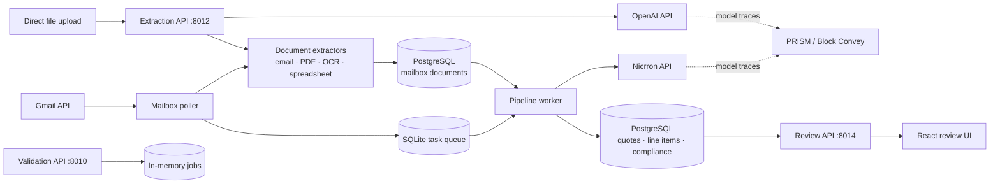
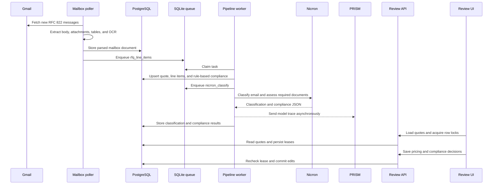
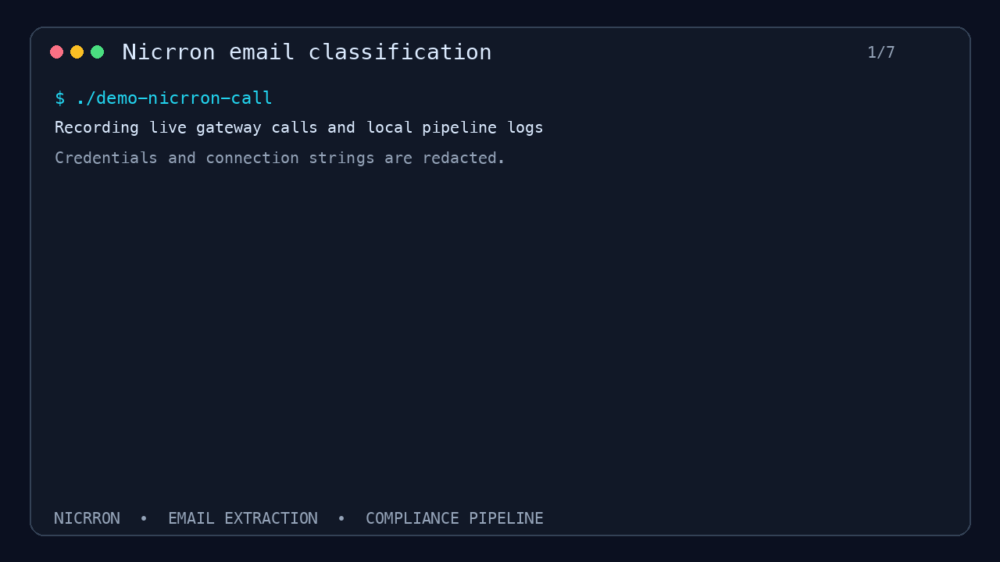

# Columbia hackathon

FastAPI services for validation, document extraction, and line-item review.
Validation jobs and direct extraction requests use in-memory storage; the RFQ
pipeline and review UI use PostgreSQL.

## Project links

- GitHub: [IamJasonBian/columbia-hackathon](https://github.com/IamJasonBian/columbia-hackathon)
- Hackathon working document: [Quote Document (Sent)](https://docs.google.com/document/d/1TeD60bNlQqb1bOKdDRpUHgEC1B-TAxk094qYutOpqyM/edit?tab=t.0)
- **Docs:** [docs/](./docs/) — [E2E pipeline flow](./docs/e2e-pipeline-flow.md), [Mermaid diagrams](./docs/email-extraction-pipeline.html)

## System architecture



### RFQ ingestion and review flow



See [docs/e2e-pipeline-flow.md](./docs/e2e-pipeline-flow.md) for a step-by-step narrative (poll → queue → worker → Postgres → review).

## Quick start

```bash
cd "/Users/jasonzb/columbia hackathon"
python3 -m venv .venv && source .venv/bin/activate
pip install -e .
export PYTHONPATH="$PWD"
export SKIP_AUTH=1
chmod +x bootstrap/run_services.sh bootstrap/mint_sa_token.py
./bootstrap/run_services.sh
```

- Validation CRUD: http://127.0.0.1:8010/docs  
- Extraction: http://127.0.0.1:8012/docs  

## Mint local SA token

```bash
export BACKEND_TOKEN_AUDIENCE="https://your-backend.example"
# optional: BACKEND_SA_FILE or BACKEND_IMPERSONATE_SERVICE_ACCOUNT
python bootstrap/mint_sa_token.py
eval "$(python bootstrap/mint_sa_token.py | grep '^export')"
export SKIP_AUTH=0
```

Use `Authorization: Bearer $LOCAL_SA_TOKEN` on CRUD routes.

## API sketch

**Validation**

- `POST /validation-jobs` — store `{ kind, payload }` (`global_config` \| `new_brand` \| `brand_personal`)
- `POST /validation-jobs/{id}/run` — execute `ValidationService` rules, persist `last_result`

**Extraction** (`extraction_service/`, port 8012)

Upload a file (multipart `file`); the result is stored and returned as `{ id, kind, document, structured }`.

- `POST /extract` — auto-detect (magic bytes → extension → content type)
- `POST /extract/email` — `.eml` / Gmail `format=raw`: headers, body (HTML flattened), every attachment extracted recursively
- `POST /extract/pdf` — layout text + tables per page; pages with no text layer are OCR'd (Tesseract)
- `POST /extract/spreadsheet` — `.xlsx` (every sheet) or `.csv`/`.tsv`; `tables[].records` are header-keyed rows
- `POST /extract/structured` — extract, then OpenAI returns JSON. Form fields: `instructions`, `json_schema` (string), `strict`, `model`, `vision` (send page images too). Needs `OPENAI_API_KEY`.
- `POST /extract/nicrron` — extract, then classify through Nicrron's OpenAI-compatible API. Form fields: `labels` (JSON array), `instructions`, `model`, `ocr`. Needs `NICRRON_API_KEY`.
- `GET /extractions`, `GET/DELETE /extractions/{id}`

```bash
brew install tesseract   # OCR for scanned PDFs/TIFFs
curl -F file=@remit.eml http://127.0.0.1:8012/extract
curl -F file=@remit.pdf -F instructions="List every deduction line" \
     http://127.0.0.1:8012/extract/structured
PYTHONPATH="$PWD" pytest tests/
```

## Line-item review UI (`review_service/` + `frontend/`, port 8014)

Google sign-in (anyone can sign up) and a table editor for `line_items`.
Clicking a row takes a lease on it; other users see it locked and can't
write it until the holder saves, cancels, or goes idle.

- Locks are rows in `line_item_locks` (one per line item, TTL `LOCK_TTL_SECONDS`, default 45s)
  renewed by a client heartbeat; a lapsed lease is free for anyone. A user holds at most one lock.
- `PATCH /api/line-items/{id}` re-checks the lease inside a transaction (`FOR UPDATE`) — 409 if you don't hold it.
- New tables (`app_users`, `app_sessions`, `line_item_locks`) are created on startup; `line_items` is not altered.

```bash
# Google: create an OAuth 2.0 "Web application" client, add http://localhost:5173
# and http://localhost:8014 as Authorized JavaScript origins, then:
export GOOGLE_CLIENT_ID=....apps.googleusercontent.com
PYTHONPATH="$PWD" python -m review_service.main      # API (+ serves frontend/dist if built)
cd frontend && npm install && npm run dev            # http://localhost:5173, proxies /api
# or: npm run build, then open http://localhost:8014
```

`REVIEW_DEV_AUTH=1` adds an email-only sign-in for testing locks with two users locally.

API: `GET /api/quotes?q=`, `GET /api/quotes/{id}` (lines + live locks),
`POST|DELETE /api/line-items/{id}/lock`, `PATCH /api/line-items/{id}?release=true`.

## PostgreSQL service logs

Import the current extraction, poller, public-view, and Cloudflare logs into the
`service_logs` table. Imports are idempotent by source file and byte offset, and
tokens/API keys are redacted before insertion.

```bash
PYTHONPATH="$PWD" python bootstrap/ingest_logs.py
```

The token-gated public view exposes the rows in insertion order at
`GET /logs?service=extraction_service&after_id=0&limit=100`. Send
`Authorization: Bearer $PUBLIC_VIEW_TOKEN`; do not put the token in the URL,
because access logs record query strings.

## Gmail persistence

Mailbox polling uses PostgreSQL as its source of truth:

```bash
python bootstrap/init_postgres.py
python bootstrap/sync_pulls_to_postgres.py   # one-time app_storage backfill
EMAIL_OAUTH_STORE=firestore python bootstrap/poll_mailbox.py mailbox@example.com
```

Both commands require `DATABASE_URL`. Use `--file-store` only for offline
development. Mailbox reads under `/pulls` are served from PostgreSQL.

## Nicrron classification setup



Nicrron provides the OpenAI-compatible classification endpoint used by direct
`/extract/nicrron` requests and queued RFQ compliance jobs.

1. Sign in to [Nicrron](https://www.nicrron.ai/) and open **Keys**.
2. Generate a Nicrron API key (`sk-af-...`).
3. Click **Add Provider Key**, choose the model provider, and add that
   provider's key. Nicrron uses bring-your-own-key (BYOK).
4. Add the backend-only configuration to `.env` or your secret manager:

```bash
NICRRON_API_KEY=sk-af-...
NICRRON_MODEL=nicrron/fastest
NICRRON_BASE_URL=https://api.nicrron.ai/v1
ENABLE_CLASSIFICATION_PIPELINE=1
```

5. Export or source those variables, then start the extraction API. Start the
   worker as well when processing mailbox jobs:

```bash
set -a; source .env; set +a
python -m extraction_service.main
python bootstrap/worker.py
```

6. Verify direct classification:

```bash
curl http://127.0.0.1:8012/extract/nicrron \
  -F file=@request.eml \
  -F 'labels=["rfq","invoice","purchase_order","other"]' \
  -F 'instructions=Use rfq when the sender asks us to quote products.'
```

The response stores the local parse in `document` and the Nicrron result in
`structured.classification`. If Nicrron cannot classify the document, the service logs the
failure and returns `classification: null`. Keep the Nicrron key out of browser code and
source control.

## PRISM observability

OpenAI structured extraction and Nicrron classification emit traces to
[PRISM](https://blockconvey.com/docs) when both `PRISMTRACE_API_KEY` and
`PRISMTRACE_PROJECT_ID` are set. Delivery runs off the request path and fails
open, so an observability outage does not break extraction.

1. Create an account at [prism.blockconvey.com](https://prism.blockconvey.com/signup).
2. In **Settings → Project**, copy the project ID. Use a separate project for
   each environment.
3. On the API keys page, create an **ingest-only** key and copy it when shown.
4. Add the values to `.env` or your deployment secret manager:

```bash
PRISMTRACE_HOST=https://prism.blockconvey.com
PRISMTRACE_PROJECT_ID=00000000-0000-0000-0000-000000000000
PRISMTRACE_API_KEY=pt-sk-...
```

5. Verify the credentials before starting traffic:

```bash
set -a; source .env; set +a
curl -sS -X POST "$PRISMTRACE_HOST/api/setup-doctor/handshake" \
  -H "Content-Type: application/json" \
  -H "X-PRISMtrace-Key: $PRISMTRACE_API_KEY" \
  -d '{"project_id":"'"$PRISMTRACE_PROJECT_ID"'","send_test_trace":true}'
```

6. Start the extraction API or pipeline worker. Calls appear under the stable
   agents `structured-extraction`, `nicrron-extraction`,
   `nicrron-classification`, and `nicrron-compliance`.

Trace payloads include model prompts and outputs, which can contain document
content and customer data. Use an environment-specific PRISM project and never
place the PRISM key in frontend code.

## Customer compliance mapping

Queued email classification also loads `config/customer_compliance.json`. An exact sender
email wins over a sender-domain match. Each customer defines the compliance documents that
must apply to every extracted RFQ line item:

```json
{
  "customer_id": "mock-customer",
  "sender_domains": ["mockcustomer.local"],
  "compliance_documents": [
    {
      "code": "food_safety_plan_haccp",
      "document_name": "Mock Food Safety Plan HACCP.pdf",
      "prompt": "Determine whether an attachment is a HACCP food safety plan."
    }
  ]
}
```

The worker sends attachment filenames and locally parsed PDF/text contents to Nicrron.
Matched documents are stored as `satisfied`; absent documents are stored as
`document_missing`. The same result is linked to each line item. Set
`CUSTOMER_COMPLIANCE_PATH` to use another local mapping file. Unmapped senders retain a
null `customer_id` and are routed to human review.

